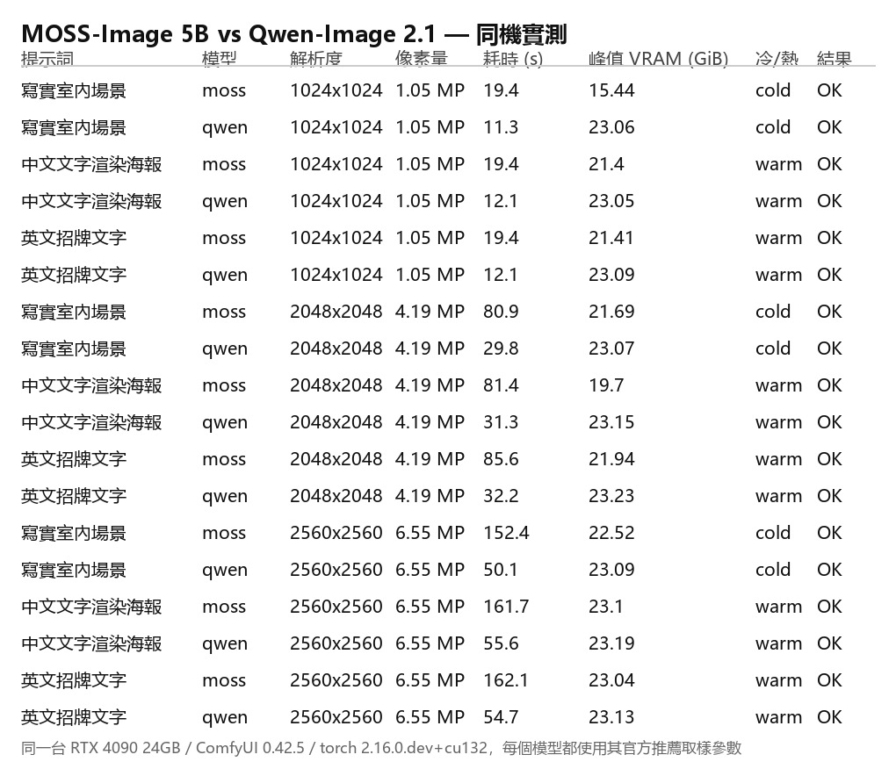
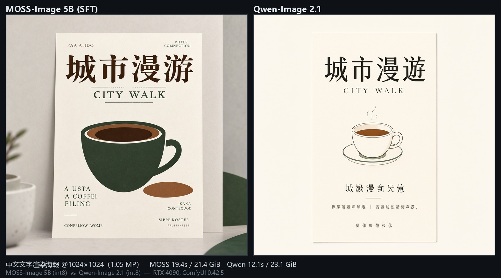
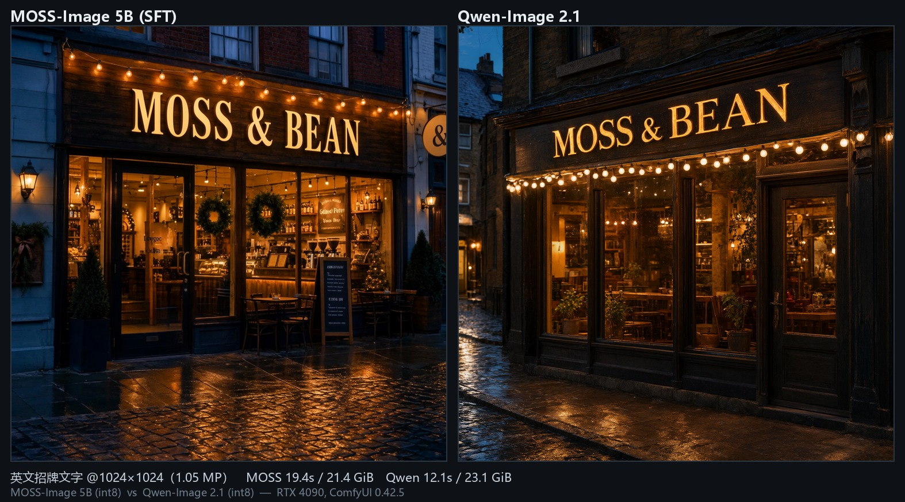
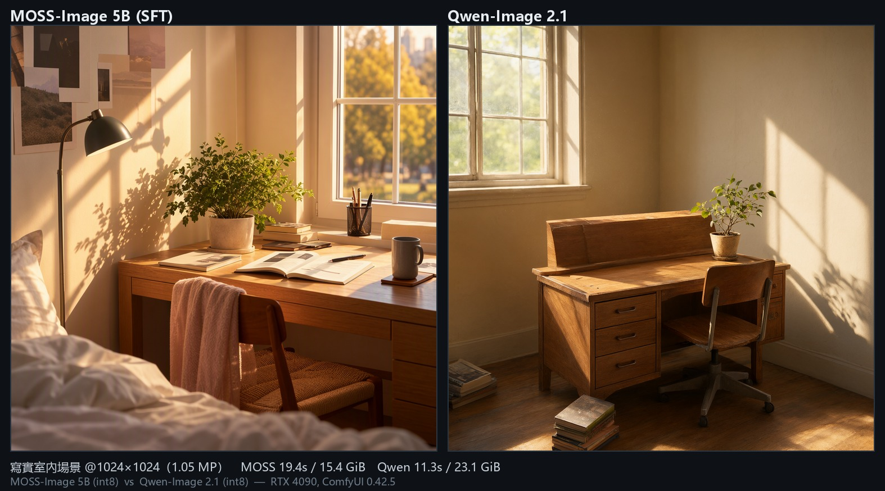
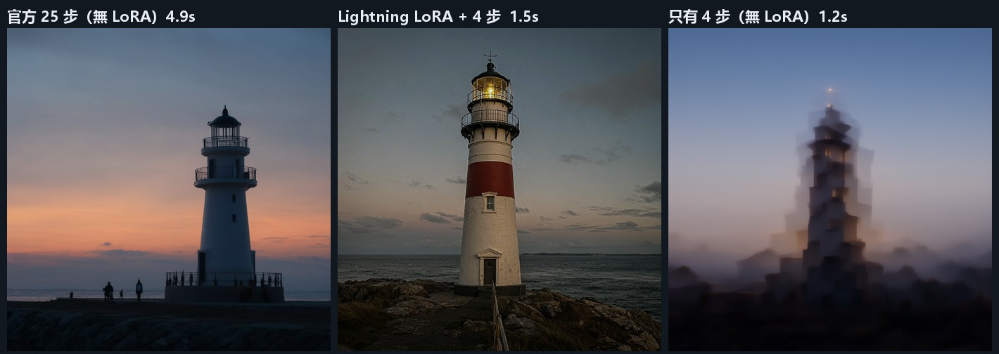

# MOSS-Image 5B vs Qwen-Image 2.1 — 同機實測比較

同一台 **RTX 4090 24GB**、同一套 **ComfyUI 0.42.5**、同一個 seed（42）、
同一組提示詞，逐張對打。**每個模型都用它自己官方推薦的取樣參數**，
比的是「開箱即用的品質與成本」，不是把某一方調到極致。

| | MOSS-Image 5B | Qwen-Image 2.1 |
| --- | --- | --- |
| 發布 | 2026-10（OpenMOSS / MOSI.AI） | 2026（Alibaba Qwen 團隊） |
| 參數量 | **5B** | **20B** |
| 架構 | 單流 DiT（single-stream），Muon optimizer 訓練 | MMDiT |
| Text encoder | `qwen3.5_9b` int8（9.08 GiB） | `qwen3vl_8b` int8（官方）/ bf16（本機 16.33 GiB） |
| VAE | `flux2-vae_small`（0.23 GiB） | `qwen_image_2.1_vae_bf16`（0.63 GiB，**4 通道含 alpha**） |
| 官方取樣 | ≥50 步 / CFG 3.0 / shift 5 / Euler + sgm_uniform / SLG skip layer 22 | 25 步 / CFG 1.0 / Euler + simple / 內建 shift |
| 負向提示詞 | 需要（官方建議 5 個負向詞） | **不需要**（CFG 1.0，positive=negative） |
| 推薦像素量 | 1M / 1.5M / 2M | 原生 2K（2048×2048） |
| 外推範圍 | 0.25M～4M（實測可到 6.55M） | 原生 2K（實測可到 6.55M） |
| 特色能力 | **JSON Layout 精準控制**（文字位置／物件增減）、中英文字渲染 | **生成＋編輯同一份權重**、多圖參考（最多 16 張）、局部編輯、**alpha 透明背景** |
| ComfyUI 支援 | v0.42.0 起原生內建（2026-10-16 合併） | 原生內建，另有 `TextEncodeQwenImage21` / `QwenImage21Cache` 等專用節點 |
| 授權 | Apache-2.0 | Apache-2.0 |

## 二、本機實測數據

測試環境：**RTX 4090 24GB ｜ ComfyUI 0.42.5 ｜ torch 2.16.0.dev20261007+cu132 ｜ seed 42**
（每次生成前呼叫 `/free` 卸載模型，避免 ComfyUI 節點快取造成的假數據）



### 2.1 生成耗時

| 解析度 | 像素量 | MOSS-Image 5B | Qwen-Image 2.1 | 倍數 |
| --- | --- | --- | --- | --- |
| 1024×1024 | 1.05 MP | **19.4 s** | **11.3～12.1 s** | 1.6～1.7× |
| 2048×2048 | 4.19 MP | **80.9～85.6 s** | **29.8～32.2 s** | 2.6～2.7× |
| 2560×2560 | 6.55 MP | **152.4～162.1 s** | **50.1～55.6 s** | 2.8～3.0× |

**Qwen-Image 2.1 全面更快，而且像素量越大差距越明顯。**

原因拆解：

- **步數**：MOSS 官方要求 ≥50 步；Qwen 官方範本用 25 步
- **取樣路徑**：MOSS 的 `SkipLayerGuidanceDiTSimple` 是 *two-pass sampling*，
  負向分支要額外跑一次；官方也提醒 SLG 會強制 eager execution（不能用 torch.compile）
- **原生解析度**：Qwen-Image 2.1 是**原生 2K**，2048² 是它的原生畫布，不需要外推；
  MOSS 的 4M 以上屬於「外推」區間，token 數暴增導致成本超線性成長

> MOSS 的 50 步 × two-pass 讓 1024² 的成本就已經是 Qwen 的 1.6～1.7 倍；
> 拉高到 4MP / 6.55MP 後差距拉大到 2.6～3.0 倍。

### 2.2 峰值 VRAM

| 解析度 | MOSS-Image 5B | Qwen-Image 2.1 |
| --- | --- | --- |
| 1024×1024 | 15.4～21.4 GiB | **23.0～23.1 GiB** |
| 2048×2048 | 19.7～21.9 GiB | **23.1～23.2 GiB** |
| 2560×2560 | 22.5～23.1 GiB | **23.1～23.2 GiB** |

**MOSS 比較省記憶體**，因為 text encoder 用 int8 的 `qwen3.5_9b`（9.08 GiB），
而 Qwen-Image 2.1 用的是 `qwen3vl_8b`（本機為 bf16 = 16.33 GiB）。
官方範本用 int8 版 `qwen3vl_8b_int8_convrot`，VRAM 會再降一些。

> 兩者在 24GB 卡上都能跑滿 6.55 MP，但 Qwen 幾乎吃滿整張卡（23.2 / 24 GiB）。

### 2.3 冷啟動 vs 熱啟動

| 情境 | MOSS 1024² | Qwen 1024² | MOSS 2048² | Qwen 2048² |
| --- | --- | --- | --- | --- |
| 冷（含模型載入） | 19.4 s | 11.3 s | 80.9 s | 29.8 s |
| 熱（模型已在記憶體） | 19.4 s | 12.1 s | 81.4 s | 31.3 s |

**在高解析度下，模型載入時間可以忽略——耗時幾乎全是取樣。**

### 2.4 ⚠️ 量測陷阱：ComfyUI 的節點快取會讓數字失真

本次實測發現一個很容易讓人publish出假數字的坑，值得單獨列出：

ComfyUI 會依**節點輸入**做執行快取。若整條工作流程（模型、seed、prompt、steps…）
之前跑過，會直接回傳上次的結果、**不重新取樣**。

`scripts/cache_test.py` 的實測結果（MOSS-Image 1024×1024）：

| # | 情境 | 耗時 | 被快取的節點 |
| --- | --- | --- | --- |
| 1 | seed=424242 首次 | **20.44 s** | （無） |
| 2 | **完全相同**的工作流程 | **0.32 s** | **全部 12 個** |
| 3 | 換 seed=424243 | 13.91 s | 只有 1～8（取樣節點有重跑） |
| 4 | 回到 seed=424242 | 14.26 s | 只有 1～8（取樣節點有重跑） |

**機制**：ComfyUI 的 `KSampler` 只在「自己的 seed 改變」時才重新取樣
（第 2 次跑 seed 相同 → 命中；第 3 次換 seed → 重跑；第 4 次換回舊 seed → 仍重跑）。

> ⚠️ 本 repo 早期版本曾把「3.0 秒」寫成 MOSS-Image 1024² 的實測值，
> 實際上那是 **smoke test 與批次測試用了逐字相同的工作流程檔造成的快取命中**。
> 真實值是 **19.4 秒**，本文件與 README 的數字都已更正。
>
> 量測前呼叫 `/free` 卸載模型（重載模型會使快取失效）或每次換 seed，即可避免。


## 三、畫面實測（同一提示詞、同一 seed）

> 完整對比圖：[docs/compare/](docs/compare/)
> （左＝MOSS-Image 5B SFT，右＝Qwen-Image 2.1）

### 3.1 中文文字渲染海報



提示詞：`一張現代簡約風格的咖啡店宣傳海報，米白色紙質背景，頂部有醒目的中文標題「城市漫遊」，下方有英文副標題「CITY WALK」…`

**兩個模型的主標題「城市漫遊」與副標題「CITY WALK」都渲染完美、筆畫正確。**
差別在風格與版面：

- **MOSS-Image**：排版層次更豐富（主標＋分隔線＋副標＋咖啡杯插畫＋底部小字欄），
  插畫有配色與材質（深綠杯身、拿鐵拉花、杯套上的葉子標誌），偏「成品海報」
- **Qwen-Image 2.1**：版面極簡、留白大、線稿咖啡杯，文字排版乾淨俐落，
  偏「設計稿／簡報模板」

> ⚠️ **兩個模型的小字都是亂碼。**
> MOSS 的頂部小字是 `PA AJOIDO`／`CHRSTBAM CEEMRERNI`，
> Qwen 的底部中文小字是 `良祝益迎何泡` 這類無意義字。
> 「大字正確、小字崩掉」是兩者共同的弱點，不是某一方的問題。

### 3.2 英文招牌文字



提示詞：`…the sign reads MOSS & BEAN in warm golden letters on a dark wooden board…`

**兩個模型都把 "MOSS & BEAN" 渲染得完全正確**，包括 `&` 符號與字距。

- **MOSS-Image**：藍調時刻（blue hour）＋暖色店內光、花環、濕潤鵝卵石反光，
  資訊量較大、構圖較滿
- **Qwen-Image 2.1**：更深的夜色、琥珀色招牌、燈串，氣氛更收斂

### 3.3 寫實室內場景



- **MOSS-Image**：畫面元素多（桌燈、書、植物、翻開的書、椅背的布、床頭、牆上畫框），
  是一個「有人住過」的場景
- **Qwen-Image 2.1**：同樣的元素但更少、更乾淨，接近商品攝影風格

> 兩邊都沒有出現手指／肢體變形，寫實度都合格。
> 風格差異是**系統性的**：MOSS 偏「敘事性構圖」，Qwen 偏「乾淨商業視覺」。

## 四、各項能力對照

> ✅＝本機實測通過　⚠️＝實測有但有落差　📄＝僅官方文件記載，未實測

| 能力 | MOSS-Image 5B | Qwen-Image 2.1 |
| --- | --- | --- |
| 中英文大標題渲染 | ✅ 實測完美 | ✅ 實測完美 |
| 密集小字 | ❌ 亂碼 | ❌ 亂碼 |
| **JSON Layout 精準控制** | ✅ **獨有**，bbox 實測精準命中 | ❌ |
| **圖像編輯 / 局部編輯** | ❌ | ✅ 實測可用（**須用 `<image1>`** 指涉參考圖） |
| **多圖參考** | ❌ | ✅ 實測可用（`image_1` / `image_2` 同時餵入） |
| **Alpha 透明背景** | ❌ | ⚠️ VAE 確實解出 4 通道 RGBA，但實測 0% 完全透明、去背效果有限 |
| **Prompt 自動改寫** | ❌ | ✅ 實測可用（`TextGenerate` + PE text encoder） |
| KV cache 加速 | ❌ | ✅ 可用，但實測**無速度差異**（見 4.6） |
| 蒸餾加速 LoRA | 官方「進行中」 | ✅ 實測可用（Lightning 4 步，3.3× 加速） |
| **LoRA 訓練** | ✅ **官方第一方支援**（KohakuMossTrainer，6.20 GiB 實測可跑） | 📄 社群支援（DiffSynth-Studio） |
| 推薦文字語言 | 英文（中文亦支援） | 中英皆可，英文 prompt 增強尤佳 |

### 4.1 MOSS JSON Layout 實測

指定 bbox 後，文字與物件**精確落在指定位置**：


用官方 README 的 Python API 寫法（layout JSON 直接當 prompt 傳）：

```json
{"summary":{"caption":"A minimalist travel poster with a cream background, a blue mountain illustration, and the title EXPLORE at the top."},
 "items":[{"label":"text","caption":"Large dark-blue uppercase title centered at the top.","text":"EXPLORE","bbox":[-472,-308,-348,308]},
          {"label":"object","caption":"A flat blue mountain illustration in the lower center.","bbox":[-256,-205,410,205]}],
 "bbox_coord_space":"abs_centralized","bbox_format":"yxyx"}
```

> ⚠️ **`MOSSImageLayoutPrompt` 節點在 API 模式下不能用**：
> `element` 是 ARRAY 型、驗證時會對元素取 hash（dict 不可 hash），
> 而正確來源 `CreateBoundingBoxes` 的 `editor_state` 是 `BOUNDING_BOXES`
> socketless widget、必須由畫布連線進來，沒有節點輸出該型別。
> **解法：直接用上面的 JSON 寫法**（官方 README 也這樣建議）。

### 4.2 Qwen 圖像編輯實測


指令寫法（**關鍵**）：

```
Keep the room, the window, the plant, the lamp and the bed in <image1> exactly as they are.
Only replace the wooden desk in <image1> with a dark walnut desk.
```

> ⚠️ **必須用 `<image1>` 明確指涉參考圖。**
> 第一次測試沒寫 `<image1>`，模型把它當一般 t2i 重新生成了一張新圖（房間都變了）。
> 加上 `<image1>` 後才真的做到「只改指定部位、其餘保留」。

### 4.3 Qwen 多圖參考實測


`TextEncodeQwenImage21` 的 `images` 用 dict 格式（最多 16 張）：

```json
"images": {"image_1": ["4", 0], "image_2": ["5", 0]}
```

prompt 裡用 `<image1>` / `<image2>` 指涉各張。

### 4.4 Qwen Alpha 通道實測（有但要正確用）

| 測試 | 輸出模式 | 完全透明 | 半透明 | 完全不透明 |
| --- | --- | --- | --- | --- |
| 一般 t2i（prompt 寫 transparent background） | **RGBA** | 0.0% | 1.3% | 98.7% |
| 官方去背做法（編輯 +「output a PNG image」） | **RGBA** | 0.0% | 6.7% | 93.3% |

- **VAE 確實解出 4 通道**（輸出檔是 RGBA）
- 但**一般 t2i 不會給你透明背景** —— 只是多了一個幾乎全滿的 alpha 通道
- 官方 `background_removal` 範本的做法是「編輯 + 指示輸出 PNG」，
  透明背景是**模型生成進 alpha 通道**、不是事後抠图；
  實測背景乾淨時有改善，但**沒有到完全透明**，主體邊緣也不是乾淨 alpha

> **結論：要透明背景，Qwen 是「比較接近」而不是「開箱即用」。**
> 真的要乾淨去背，傳統工具（rembg 等）仍然更可靠。

### 4.5 Qwen Prompt 自動改寫（Prompt Enhancer）實測


輸入只有六個字 `a cafe poster`，PE 模型改寫成一份完整的結構化海報概念書：

> Here is a complete concept for a warm, vintage-style café poster. The design uses earthy
> browns, cream paper texture, botanical line art, and clear typographic hierarchy…
>
> ### **Poster Concept: "Good Coffee, Good Day"**
> A vertical A2-style café wall poster with a distressed cream background, dark coffee-brown
> border, central headline, product illustration, menu board, and footer details.
>
> * **Background:** Warm aged parchment beige with subtle grain, speckles, and worn edges.
> * **Border:** A double-line rectangular frame in dark espresso brown…
> * **Main Headline (Upper Center):** Large condensed serif lettering reading "GOOD COFFEE," in dark brown.

**效果差異非常明顯**：

| | 標題 | 畫面 |
| --- | --- | --- |
| 原始 prompt 直接生成 | `BIRON H TREE`（亂碼） | 構圖雜亂 |
| PE 改寫後 | `GOOD COFFEE, Good Day`（正確） | 專業海報，含插畫與菜單板 |
| PE thinking 模式 | `BREWED Goodness` + `COZY CUPS COFFEE · PASTRIES · GOOD VIBES` | 更精緻 |

> **PE 對「文字渲染」特別有價值**——因為它把想渲染的文案明確寫進去，
> 模型就不會自己亂猜要寫什麼字。

**接法**（`TextGenerate` 的 display name 是 **Generate Text**）：

```
CLIPLoader(qwen3.5_9b_qwen_image_2.1_pe_t2i.int8_convrot, type=moss_image)
  └─ TextGenerate(clip, prompt=原始 prompt, max_length=1024,
                  sampling_mode="on",
                  "sampling_mode.temperature"=0.7, "sampling_mode.top_k"=64,
                  "sampling_mode.top_p"=0.95, "sampling_mode.min_p"=0.05,
                  "sampling_mode.repetition_penalty"=1.05, "sampling_mode.seed"=42,
                  thinking=False/True, use_default_template=True)
       └─ TextEncodeQwenImage21(prompt=改寫後的文字)
            └─ KSampler → VAEDecode → SaveImage
```

> ⚠️ **兩個 API 陷阱：**
> 1. `TextGenerate` 的 `sampling_mode` 是 **dynamic combo**：
>    API 要傳**選項 key 字串**（`"on"` / `"off"`），
>    子參數要帶 **`"sampling_mode."` 前綴**（如 `"sampling_mode.seed"`），
>    平鋪或用 dict 包都會失敗。
> 2. `TextEncodeQwenImage21` 的輸入名是 **`prompt`** 不是 `text`。
>
> 實測耗時（含 PE 模型載入與改寫）：**18.8～22.0 秒**。

### 4.6 Qwen KV cache 實測：**無速度差異**

`QwenImage21Cache` 有 `device`（auto/gpu/cpu/off）與 `dtype`（default/int8/int4），
官方說「off 會每步重算 prefix，是排除 cache 影響的方法」。

在**編輯工作流程**（1024×1024、1 張參考圖、25 步）實測五種設定：

| 設定 | 耗時 |
| --- | --- |
| 完全不放 cache 節點 | **4.6 s** |
| `device=off, dtype=default`（控制組） | **4.5 s** |
| `device=auto, dtype=default`（預設） | **4.6 s** |
| `device=cpu, dtype=int8` | **4.9 s** |
| `device=gpu, dtype=int4` | **4.5 s** |

**結論：五種設定幾乎沒有差異（4.5～4.9 秒，落在雜訊範圍）。**

原因：節點 tooltip 寫的是「Quantization **potentially speeds up edit workflows when
memory starved**」——這是**記憶體吃緊時的解法，不是速度優化**。
24GB 卡跑 1024² 單張參考圖本來就不缺記憶體，cache 省下的那點重算成本可以忽略。

> **什麼時候才有意義？** 2K 以上 + 多張參考圖（最多 16 張）把 VRAM 撐滿時，
> 才有機會看到差別。本機 24GB 跑不滿那個條件，所以無法實測。
> 換句話說：**在 24GB 卡上，這個節點可以先不用管。**

### 4.7 Qwen Lightning 4 步 LoRA 實測：**3.3 倍加速且品質不輸**



| 設定 | 耗時 | 畫面品質 |
| --- | --- | --- |
| 官方 25 步（無 LoRA） | **4.9 s** | 正常 |
| **Lightning LoRA + 4 步** | **1.5 s** | ✅ 細節豐富（紅白條紋、岩石前景、雲層紋理），**不輸 25 步** |
| 只有 4 步（無 LoRA） | 1.2 s | ❌ **明顯糊掉**，塔身糊成一片 |

> **重點：LoRA 才是讓 4 步可行的關鍵。**
> 同樣 4 步，加 LoRA 品質完好、不加 LoRA 直接崩掉——
> base 模型需要的是對應的蒸餾排程，單純把 steps 砍到 4 不會有效果。

**接法**：

```
UNETLoader → LoraLoaderModelOnly(lora_name=Qwen-Image-2.1-Lightning-...safetensors,
                                  strength_model=1.0) → KSampler(steps=4, cfg=1, euler, simple)
```

LoRA 檔案：`lightx2v/Qwen-Image-2.1-Lightning` 的 `pytorch_lora_weights.safetensors`（**64 MB**）。

> 官方另有 **Qwen-Image-2.1 Turbo**（完整模型或 `qwen_image_2.1_turbo_lora_avg_rank_178_bf16.safetensors`），
> 官方建議 **8 步 / cfg 1**（不是 4 步）。本機未實測。

### 4.8 一句話總結

> **Qwen-Image 2.1 是「什麼都能做、而且快」的成熟產品；**
> **MOSS-Image 5B 是「小、便宜、而且能精準控制版面」的基底模型。**
>
> 兩者的**文字渲染能力在實測中幾乎打平**（大標題都完美、小字都亂碼）。
> 真正的分野不在畫質，而在**功能邊界**：
> Qwen 有編輯與多圖參考，MOSS 有 layout 與官方 LoRA 生態。

## 五、結論與選用建議

### 各取所需

| 你的需求 | 選哪個 | 理由 |
| --- | --- | --- |
| 日常出圖、要快 | **Qwen-Image 2.1** | 快 1.6～4.8 倍，VRAM 幾乎吃滿但原生 2K |
| 圖像編輯 / 改局部 | **Qwen-Image 2.1** | MOSS 完全沒有，MOSS 要編輯得自己 fine-tune |
| 透明背景素材 | **Qwen-Image 2.1** | 唯一原生支援 alpha 通道 |
| 海報排版、要控制文字位置 | **MOSS-Image** | JSON Layout 是獨有能力 |
| 練自己的 LoRA（風格／人物） | **MOSS-Image** | 官方第一方訓練器，6 GB 就能跑，流程最完整 |
| 6GB～8GB 小顯卡 | **MOSS-Image** | 官方 6 GB 實測可行；Qwen 實測要 23.6 GiB |
| 省 VRAM | **MOSS-Image** | text encoder 較小，峰值低 2～8 GiB |

### 一句話總結

> **Qwen-Image 2.1 是「什麼都能做、而且快」的成熟產品；**
> **MOSS-Image 5B 是「小、便宜、而且能精準控制版面」的基底模型。**
>
> 兩者的**文字渲染能力在實測中幾乎打平**（大標題都完美、小字都亂碼）。
> 真正的分野不在畫質，而在**功能邊界**：
> Qwen 有編輯與 alpha，MOSS 有 layout 與官方 LoRA 生態。

## 六、實測方法與限制

**方法**

- 同一台機器、同一個 ComfyUI、同一個 seed（42）、同一組提示詞
- 每個模型都用**自己官方推薦的取樣參數**（MOSS 50 步/CFG 3/shift 5/SLG 22；
  Qwen 25 步/CFG 1/Euler+simple）
- 每次生成前呼叫 `/free` 卸載模型，避免 ComfyUI 節點快取造成假數據
- 耗時取伺服器端 `execution_start` → `execution_success` 的時間戳；
  VRAM 由背景執行緒輪詢 `nvidia-smi` 取峰值

**限制**

- 只測了 SFT 版的 MOSS-Image（Base 版另有實測見 [LORA_TRAINING.md](LORA_TRAINING.md)）
- 本機 Qwen-Image 2.1 的 text encoder 用的是 **bf16** 版（16.33 GiB），
  官方範本用 int8 版，VRAM 數字會再低一些
- 3 組提示詞的視覺比較是**主觀判讀**，非盲測或量化指標
- 未測 ControlNet / 角色一致性 / LoRA 品質
- **Qwen 的官方 Turbo 模型／Turbo LoRA 未實測**（官方建議 8 步 / cfg 1）；
  已實測的是社群 `lightx2v/Qwen-Image-2.1-Lightning`（4 步）
- **KV cache 在「記憶體吃緊」情境下的效果無法在本機驗證**：
  24GB 卡跑 1024² 單張參考圖本來就不缺記憶體，五種設定實測無差異

## 七、相關文件

- **[DECISION.md](DECISION.md) — 選用速查卡**（什麼時候用哪一個，一頁看完）

## 八、重現方式

```powershell
# 完整對打（3 提示詞 × 2 模型 × 3 解析度 = 18 次）
powershell -ExecutionPolicy Bypass -File scripts\run_h2h.ps1 -Out output\h2h -Sizes 1024,2048,2560

# 產生對比圖
python scripts\make_h2h_compare.py

# 五項獨有能力驗證（alpha / 編輯 / 多圖參考 / 去背 / MOSS Layout）
python scripts\verify_qwen_extras.py output\extras

# 驗證 ComfyUI 節點快取會不會影響量測
python scripts\cache_test.py
```


