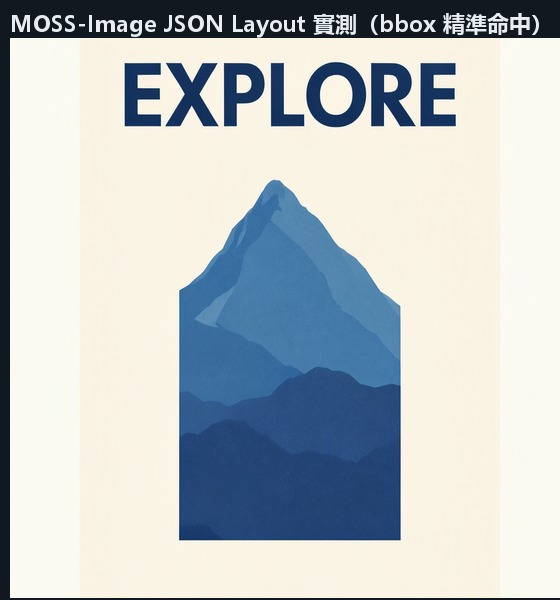
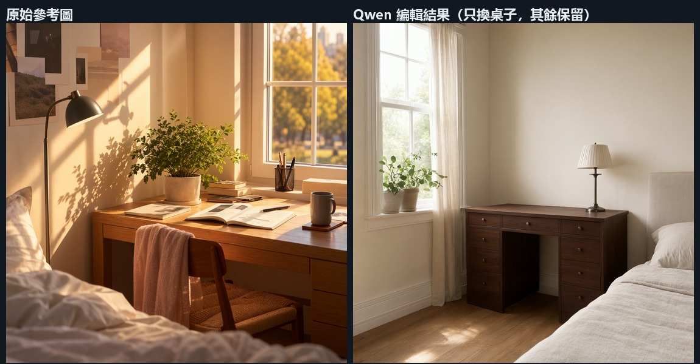
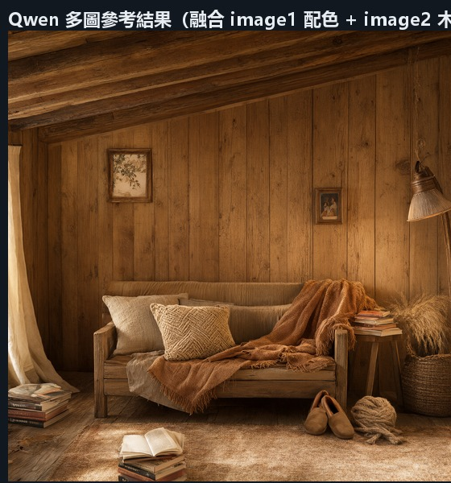
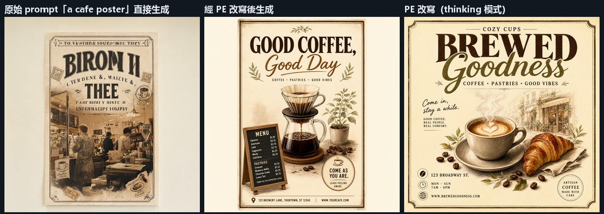
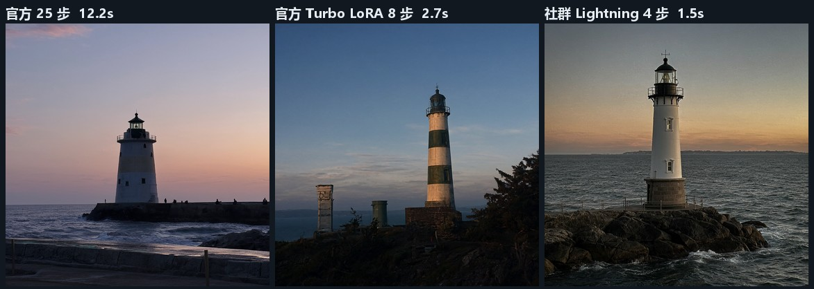
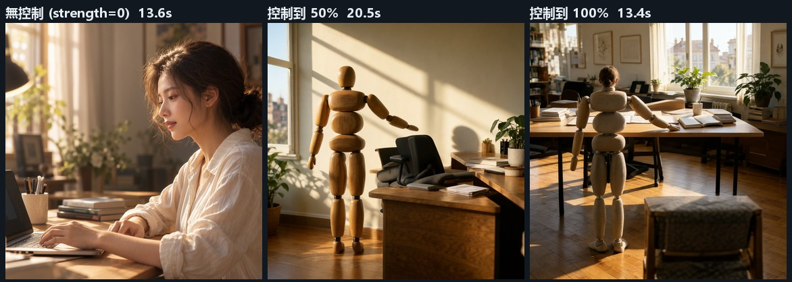

# 選用速查卡 — MOSS-Image 5B vs Qwen-Image 2.1

一頁看完「什麼時候用哪個」。所有數據都來自同機實測，細節見 [COMPARISON.md](COMPARISON.md)。

---

## 一、30 秒決策

| 你的狀況 | 選 | 實測依據 |
| --- | --- | --- |
| 要**改**一張既有的圖（換物件、改局部） | **Qwen** | ✅ 實測可用（見下方「注意」） |
| 要**多張參考**（風格圖 + 主體圖） | **Qwen** | ✅ 實測可用，image_1 / image_2 同時餵入 |
| 要**透明背景 PNG** | **Qwen** | ⚠️ VAE 有 alpha 通道，但實測去背效果有限（見下方「注意」） |
| 要**把文字放到指定位置**（海報版面、產品圖） | **MOSS** | ✅ 實測 bbox 精準命中 |
| 要**練自己的 LoRA**（尤其真人） | **MOSS** | ✅ 官方第一方工具，6.20 GiB 實測可跑 |
| 顯卡 **< 24GB** | **MOSS** | 實測 15.4～23.1 GiB vs Qwen 23.0～23.2 GiB |
| 日常出圖、**量大** | **Qwen** | 快 1.6～3.0 倍；加官方 Turbo LoRA 再快 4.5 倍 |
| 要出**帶字的海報**、想要更專業的版面 | **Qwen + PE 改寫** | 實測差異最明顯（亂碼標題 → 正確標題） |
| 要**按草稿／3D 模型擺位**出圖 | **MOSS + 色／深控制** | `MOSSImageControl` 實測能鎖定位置與姿態 |
| 只是要一張**寫實照片 / 中文大標題** | **Qwen** | 實測畫質打平，選快的即可 |

---

## 二、一條判斷線

```
                你要做這件事？
                      │
     ┌────────────────┼────────────────┐
     │                │                │
 改既有圖/局部編輯  多圖參考        透明背景
 放文字到指定位置   要訓練自己的LoRA
     │                │                │
  ┌──┴──┐          ┌──┴──┐         Qwen
  │     │          │     │
Qwen   MOSS       Qwen  MOSS        ↓
(無此功能)        (無此功能)    以上任一 → Qwen

        都不是（單純生成一張圖）
                      │
                 VRAM < 24GB ?
                 ├── 是 → MOSS
                 └── 否 → Qwen
```

---

## 三、關鍵數據

### 耗時（RTX 4090 24GB，各用官方推薦參數）

| 解析度 | 像素量 | MOSS-Image 5B | Qwen-Image 2.1 | 差距 |
| --- | --- | --- | --- | --- |
| 1024×1024 | 1.05 MP | **19.4 s** | **11.3～12.1 s** | 1.6～1.7× |
| 2048×2048 | 4.19 MP | **80.9～85.6 s** | **29.8～32.2 s** | 2.6～2.7× |
| 2560×2560 | 6.55 MP | **152.4～162.1 s** | **50.1～55.6 s** | 2.8～3.0× |

**像素量越大，Qwen 優勢越明顯。** MOSS 走 50 步 × two-pass SLG，
且 4MP 以上屬官方定義的「外推」區間；Qwen-Image 2.1 是**原生 2K**。

### 峰值 VRAM

| 解析度 | MOSS-Image 5B | Qwen-Image 2.1 |
| --- | --- | --- |
| 1024×1024 | 15.4～21.4 GiB | 23.0～23.1 GiB |
| 2048×2048 | 19.7～21.9 GiB | 23.1～23.2 GiB |
| 2560×2560 | 22.5～23.1 GiB | 23.1～23.2 GiB |

MOSS 較省（text encoder 是 int8 的 `qwen3.5_9b` 9.08 GiB；
Qwen 用 `qwen3vl_8b`，本機為 bf16 16.33 GiB，官方範本用 int8 會更低）。

### 畫質（同一提示詞、同一 seed）

文字渲染**幾乎打平**：

- 中文「城市漫遊」+ 英文「CITY WALK」→ 兩邊主標題都筆畫正確
- 英文 "MOSS & BEAN" → 兩邊連 `&` 都完全正確
- **小字都是亂碼**（MOSS 出 `PA AJOIDO`、Qwen 出 `良祝益迎何泡`）

風格差異是系統性的：
**MOSS 偏敘事性構圖**（元素多、像有人住過）、
**Qwen 偏乾淨商業視覺**（元素少、接近商品攝影）。

---

## 四、實測驗證的獨有能力

### MOSS-Image：JSON Layout 精準控制 ✅

指定 bbox 後，文字與物件**精確落在指定位置**（實測 1024×1024）：



用官方 README 的 Python API 寫法（layout JSON 直接當 prompt 傳）：

```json
{"summary":{"caption":"A minimalist travel poster with a cream background, a blue mountain illustration, and the title EXPLORE at the top."},
 "items":[{"label":"text","caption":"Large dark-blue uppercase title centered at the top.","text":"EXPLORE","bbox":[-472,-308,-348,308]},
          {"label":"object","caption":"A flat blue mountain illustration in the lower center.","bbox":[-256,-205,410,205]}],
 "bbox_coord_space":"abs_centralized","bbox_format":"yxyx"}
```

- `bbox` 為 `[ymin, xmin, ymax, xmax]`，**相對畫布中心**的像素座標
- `label` 為 `text` / `object` / `character`
- `text` 欄位是「要渲染的那段字」

> ⚠️ `MOSSImageLayoutPrompt` 節點**在 API 模式下不能用**：
> 它的 `element` 是 ARRAY 型、驗證時會對元素取 hash（dict 不可 hash），
> 而正確來源 `CreateBoundingBoxes` 節點的 `editor_state` 是
> `BOUNDING_BOXES` socketless widget、必須由畫布連線進來，沒有節點輸出該型別。
> **解法：直接用上面的 JSON 寫法**（官方 README 也這樣建議）。

### Qwen-Image 2.1：圖像編輯 ✅



指令寫法（**關鍵**）：

```
Keep the room, the window, the plant, the lamp and the bed in <image1> exactly as they are.
Only replace the wooden desk in <image1> with a dark walnut desk.
```

> ⚠️ **必須用 `<image1>` 明確指涉參考圖。**
> 第一次測試沒寫 `<image1>`，模型把它當一般 t2i 重新生成了一張新圖（房間都變了）。
> 加上 `<image1>` 後才真的做到「只改指定部位、其餘保留」。

### Qwen-Image 2.1：多圖參考 ✅



`TextEncodeQwenImage21` 的 `images` 欄位用 dict 格式（最多 16 張）：

```json
"images": {"image_1": ["4", 0], "image_2": ["5", 0]}
```

prompt 裡用 `<image1>` / `<image2>` 指涉各張。

### Qwen-Image 2.1：Alpha 通道 ⚠️ 有但要正確用

| 測試 | 輸出模式 | 完全透明 | 半透明 | 完全不透明 |
| --- | --- | --- | --- | --- |
| 一般 t2i（prompt 寫 transparent background） | **RGBA** | 0.0% | 1.3% | 98.7% |
| 官方去背做法（編輯 + 「output a PNG image」） | **RGBA** | 0.0% | 6.7% | 93.3% |

- **VAE 確實解出 4 通道**（輸出檔是 RGBA）
- 但**一般 t2i 不會給你透明背景** —— 只是多了一個幾乎全滿的 alpha 通道
- 官方 `background_removal` 範本的做法是「編輯 + 指示輸出 PNG」，
  透明背景是**模型生成進 alpha 通道**、不是事後抠图；
  實測背景乾淨時有改善，但**沒有到完全透明**，主體邊緣也不是乾淨 alpha

> **結論：要透明背景，Qwen 是「比較接近」而不是「開箱即用」。**
> 真的要乾淨去背，傳統工具（rembg 等）仍然更可靠。
> 這點不該被「支援 alpha」四個字誤導。

---

### Qwen-Image 2.1：Prompt 自動改寫 ✅（對文字渲染特別有用）



輸入只有六個字 `a cafe poster`，PE 模型改寫成一份完整的結構化海報概念書
（含配色、邊框、主標題字樣、插畫描述），再餵給影像模型：

| | 標題 | 畫面 |
| --- | --- | --- |
| 原始 prompt 直接生成 | `BIRON H TREE`（亂碼） | 構圖雜亂 |
| **PE 改寫後** | `GOOD COFFEE, Good Day`（正確） | 專業海報，含插畫與菜單板 |
| PE thinking 模式 | `BREWED Goodness` + `COZY CUPS COFFEE · PASTRIES · GOOD VIBES` | 更精緻 |

> **為什麼值得特別提**：PE 把「想渲染的文案」明確寫進 prompt，
> 模型就不會自己亂猜要寫什麼字。**要出帶字的海報，PE 是最快的改善手段。**
>
> 實測耗時 18.8～22.0 秒（含 PE 模型載入與改寫），
> PE text encoder 本身要 **8.82 GiB**（`qwen3.5_9b_qwen_image_2.1_pe_t2i`）。

### Qwen-Image 2.1：加速 LoRA ✅（官方 Turbo 8 步 / 社群 Lightning 4 步）



| 設定 | 步數 | 耗時 | 加速比 | LoRA 大小 | 性質 |
| --- | --- | --- | --- | --- | --- |
| 無 LoRA（官方推薦） | 25 | 12.2 s | 1× | — | — |
| **官方 Turbo LoRA** | 8 | **2.7 s** | **4.5×** | 871 MB | ✅ 官方 |
| **社群 Lightning LoRA** | 4 | **1.5 s** | **8.1×** | 64 MB | ⚠️ 社群 |

> **LoRA 才是讓低步數可行的關鍵** — 單純把 steps 砍到 4 不會有效果，
> 同樣 4 步不加 LoRA 會明顯糊掉。
> 官方 Turbo LoRA 品質穩、來源官方；社群 Lightning 更快但只有 64 MB。

### Qwen-Image 2.1：KV cache ⚠️ 記憶體吃緊時才有用

| 情境 | `device=off` | `device=auto` | 差異 |
| --- | --- | --- | --- |
| 1024² + 1 張參考圖 | 4.5 s | 4.6 s | 無 |
| **2048² + 8 張參考圖** | **31.2 s** | **23.3 s** | **快 25%** |

> 節點 tooltip 說的「speeds up edit workflows **when memory starved**」完全準確。
> 批次做多參考圖編輯時記得開 `device=auto`；出一兩張小圖可以先不管。

### MOSS-Image 5B：色／深控制 adapter ✅



`MOSSImageControl` 節點 + `moss-control.safetensors`（299 MB，**社群版** `darask0`）。

給定色域圖 + 深度圖後，**3D 人偶精確出現在指定位置**：

| 設定 | 耗時 | 結果 |
| --- | --- | --- |
| 無控制（`strength=0`） | 13.6 s | 正常真人 |
| 控制到 50% | 20.5 s | **人偶出現在指定位置** |
| 控制到 100% | 13.4 s | 人偶佔更大版面 |

**色域圖**＝每個區域一個純色（顏色只是 ID，不代表實際顏色，黑色＝未指定）；
**深度圖**＝灰階，**近＝白**。

> ⚠️ 實測重現了 README 明載的「mannequin look」限制：
> 餵 3D 人偶深度圖會帶出人偶表面質感。
> README 建議 `end_percent=0.5` 並**搭配 region prompts**（每個顏色一句描述）
> 才會變成「地圖上那個位置的真實人物」——這點本機尚未測。

## 五、實務組合建議

兩套權重可以共存（檔名不衝突，共約 42 GB），**不必二選一**：

| 流程 | 做法 |
| --- | --- |
| 大量出圖 | 全用 Qwen（快 1.6～3 倍） |
| 先求快再求穩 | Qwen 出初稿 → 挑選 → MOSS 重繪（品質較穩但慢） |
| 海報類 | Qwen 出背景 → **MOSS Layout** 鎖定文案位置重繪 |
| 風格統一 | MOSS 練 LoRA → 套在 Qwen 的流程上 |
| 小顯卡 | MOSS 全包（省 VRAM + 官方 LoRA 支援） |

---

## 六、兩個模型的檔案對照（本機已裝好）

| | MOSS-Image 5B | Qwen-Image 2.1 |
| --- | --- | --- |
| DiT | `moss_image_sft_int8_convrot` (5.04 GiB) | `qwen_image_2.1_int8_convrot` (6.76 GiB) |
| DiT（另一用途） | `moss_image_base_int8_convrot` (5.04 GiB) | — |
| Text encoder | `qwen3.5_9b_int8_convrot` (9.08 GiB) | `qwen3vl_8b_bf16` (16.33 GiB) |
| VAE | `flux2-vae_small` (0.23 GiB) | `qwen_image_2.1_vae_bf16` (0.63 GiB) |
| 放哪 | `models/diffusion_models`、`models/text_encoders`、`models/vae` | 同左 |

**MOSS 的 SFT / Base 別拿錯**：SFT 直接生成用；Base 是留給 train LoRA 用的
（未後訓練、完整保留訓練資訊）。實測兩者差異明顯。

---

## 七、重現方式

```powershell
# 18 次完整對打 + 對比圖
powershell -ExecutionPolicy Bypass -File scripts\run_h2h.ps1 -Out output\h2h -Sizes 1024,2048,2560
python scripts\make_h2h_compare.py output\h2h output\h2h_compare

# 五項獨有能力驗證（alpha / 編輯 / 多圖參考 / 去背 / MOSS Layout）
python scripts\verify_qwen_extras.py output\extras

# 加速功能驗證（KV cache 五種設定 / Lightning 4 步 LoRA / PE 自動改寫）
python scripts\verify_qwen_accel.py output\accel
# 只跑 PE（需先裝好 8.82 GiB 的 PE text encoder）
python scripts\verify_qwen_accel.py output\accel --pe-only

# 第二輪：官方 Turbo LoRA / MOSS 色深控制 / KV cache 記憶體吃緊情境
python scripts\verify_qwen_accel2.py output\accel2

# 驗證 ComfyUI 節點快取對量測的影響
python scripts\cache_test.py
```
