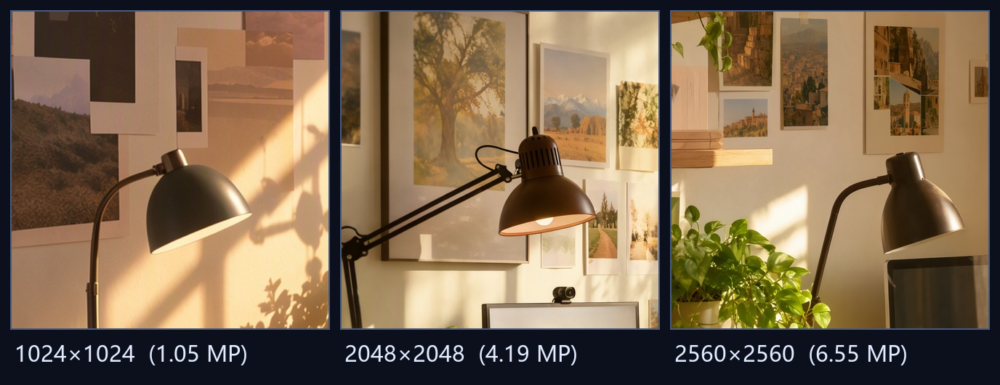
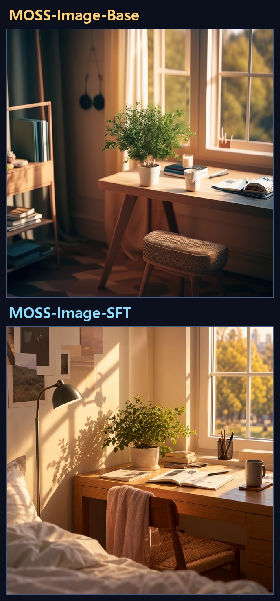
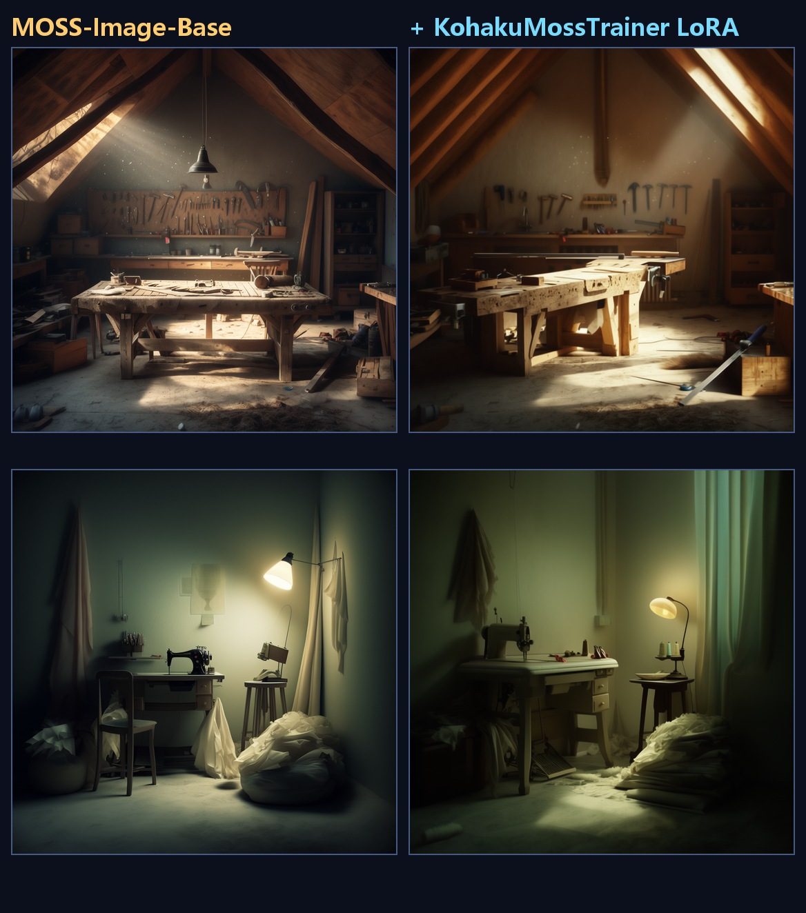

# MOSS-Image × ComfyUI

MOSS-Image 5B 在 ComfyUI 上的完整實作：**工作流、LoRA 訓練、對比工具與實測指南**（模型權重不含）。

MOSS-Image 是 2026-10 由 OpenMOSS 釋出的 **5B 參數 DiT 基底模型**，特色是中英文複雜文字渲染與 JSON Layout 精準控制。
ComfyUI 原生支援在 **2026-10-16** 合併（commit `e087d8f6`），**v0.42.0 起的正式版已內建**。

> ⚠️ 本 repo 只收錄 **工作流／腳本／文檔**，所有模型權重（`*.safetensors` 等）都經 `.gitignore` 排除、不會上傳。
> 模型請自行放到 `ComfyUI\models\` 對應子目錄（見「權重取得」）。

## 一、這是什麼

一套針對 **RTX 4090（24GB VRAM）** 實測過的 MOSS-Image 工作環境：

| 面向 | 內容 |
| --- | --- |
| **高解析生成** | 官方建議 1M～2M 像素；實測 **2048×2048（4.19 MP）84 秒**、**2560×2560（6.55 MP）147 秒** 直出成功 |
| **LoRA 訓練** | KohakuMossTrainer（LyCORIS LoHa），實測 **峰值 VRAM 6.20 GiB**、**5.0 秒/步**，匯出的 adapter 直接可在 ComfyUI 用 |
| **風格對照** | Base vs SFT、Base vs Base+LoRA、跨解析度細節保留，三種對比圖產生器 |
| **可重現** | 工作流程以 Python 產生（不手改 JSON）、執行／輪詢／取圖／計時全部腳本化 |

## 二、實測結果（RTX 4090 24GB / ComfyUI 0.42.5 / torch 2.16.0.dev+cu132）

### 2.1 生成：直出 4MP 成立

| 標籤 | 解析度 | 像素量 | 耗時 |
| --- | --- | --- | --- |
| `sft_1024` | 1024×1024 | 1.05 MP | 19.4 s |
| `sft_2048` | 2048×2048 | **4.19 MP** | 84.1 s |
| `sft_2560` | 2560×2560 | **6.55 MP**（超出官方外推上限） | 147.5 s |

官方 USERGUIDE 建議 1M～2M 像素、4M（≈2K）為外推上限；**實測 4M 與 6M 都能直出，且未見手指／肢體變形**。



同一構圖、同一鏡位、100% 裁切放大：1.05 MP 明顯較軟，4.19 MP 相框與燈罩細節清楚，6.55 MP 葉片脈絡與相框內的畫都銳利可辨。

### 2.2 Base vs SFT：定位完全不同



同 seed、同提示詞。**SFT** 是構圖完整、光影成熟的成片；**Base** 明顯素樁得多。
這正好對應官方定位：Base 未經後訓練、完整保留訓練資訊，**留給大家 train LoRA 用**；SFT 才是直接生成用的版本。

### 2.3 LoRA：Base → Base+LoRA



左＝Base、右＝套上 KohakuMossTrainer 訓練的 LoRA（兩組不同的 seed／提示詞）。
暖色午後光線的風格確實被學進去了。

## 三、權重取得

官方 ComfyUI 格式權重（Apache-2.0）：**https://huggingface.co/Comfy-Org/MOSS-Image**

用本 repo 的腳本自動下載並放對位置：

```powershell
python scripts\download_moss.py
```

| 檔案 | 大小 | 目標資料夾 |
| --- | --- | --- |
| `moss_image_sft_int8_convrot.safetensors` | 5.04 GiB | `models/diffusion_models/` |
| `moss_image_base_int8_convrot.safetensors` | 5.04 GiB | `models/diffusion_models/` |
| `qwen3.5_9b_int8_convrot.safetensors` | 9.08 GiB | `models/text_encoders/` |
| `flux2-vae_small.safetensors` | 0.23 GiB | `models/vae/` |

共 19.39 GiB，實測 401 秒下載完畢。
選 **int8_convrot** 變體是因為它對應 ComfyUI 的 `comfy_kitchen` CUDA backend（sm89+），在 24GB 卡上最省記憶體。

> 也提供 bf16 版本（`moss_image_sft_bf16.safetensors` 等，各 9.46 GiB），但 VRAM 需求明顯較高。

## 四、快速上手

### 4.1 環境

- ComfyUI **v0.42.0 以上**（原生支援 MOSS-Image；v0.41.3 尚無）
- 建議 `python_embeded_nightly`（torch nightly）
- Python 依賴：`huggingface_hub`、`Pillow`（對比圖用）

### 4.2 啟動 ComfyUI

```powershell
$env:PYTHONIOENCODING='utf-8'; $env:PYTHONUTF8='1'
D:\AI\ComfyUI\python_embeded_nightly\python.exe D:\AI\ComfyUI\main.py `
  --listen 127.0.0.1 --port 8188 --use-ck-attention
```

### 4.3 生成一張圖

```powershell
# 產生工作流程（API 格式）
python scripts\moss_workflow.py --out wf.json --model sft --width 2048 --height 2048 --seed 42

# 送出 → 輪詢 → 取圖 → 記錄耗時
python scripts\run_moss.py --wf wf.json --tag my_test
```

`moss_workflow.py` 產生的節點接法（**注意：不可照搬 `ModelSamplingSD3`**，官方明確警告原生模型的 timestep multiplier 不同）：

```
UNETLoader
  └─ ModelSamplingAuraFlow(shift=5)                 # 原生模型的 shift 調整用這個
       └─ SkipLayerGuidanceDiTSimple(single_layers="22")   # 負向分支跳過 layer 22
            └─ KSampler(Euler / sgm_uniform / CFG 3 / 50 steps)
                 ├─ CLIPTextEncode(positive)  ← CLIPLoader(type=moss_image)
                 ├─ CLIPTextEncode(negative)  ← "nsfw, worst quality, bad anatomy, watermark, jpeg artifact"
                 └─ EmptyLatentImage → VAEDecode → SaveImage
```

### 4.4 批次跑解析度矩陣

```powershell
powershell -ExecutionPolicy Bypass -File scripts\run_batch.ps1
```

### 4.5 對比圖

```powershell
python scripts\make_compare.py
```

### 4.6 環境變數

| 變數 | 用途 | 預設 |
| --- | --- | --- |
| `MOSS_SERVER` | ComfyUI API 位址 | `http://127.0.0.1:8188` |
| `MOSS_MODELS` | ComfyUI `models` 資料夾 | `D:\AI\ComfyUI\models` |
| `MOSS_OUT` | 產出圖／工作流程資料夾 | `<repo>/output` |
| `MOSS_HF_HOME` | HF 權重快取 | `D:\AI\hf_cache` |
| `MOSS_COMFY` | ComfyUI 根目錄（PowerShell 腳本用） | `D:\AI\ComfyUI` |

## 五、LoRA 訓練

完整流程見 **[LORA_TRAINING.md](LORA_TRAINING.md)**。摘要：

```powershell
git clone https://github.com/KohakuBlueleaf/KohakuMossTrainer
cd KohakuMossTrainer
powershell -ExecutionPolicy Bypass -File scripts\install\install.ps1
kohakumoss-doctor                      # 確認 missing: nothing

kohakumoss-config new train --weights <ComfyUI>\models --data <dataset> `
  --source folder --algo loha --name my_lora --steps 150 --vram 24 --precision bf16

kogine run scripts/data/inspect_data.py  --config configs/user/my_lora_data.py
kogine run scripts/data/cache_text.py     --config configs/user/my_lora_data.py
kogine run scripts/data/cache_latents.py  --config configs/user/my_lora_data.py
kogine run scripts/train/moss.py          --config configs/user/my_lora.py
```

訓練完成後 `runs/moss/my_lora/export/` 會有 `my_lora-comfy.safetensors` 與 `my_lora-lycoris.safetensors`，
把 **`-lycoris`** 那份放進 `ComfyUI\models\loras\`，`LoraLoader` 就能直接選。

## 六、目錄結構

```
moss-image-comfyui\
├── README.md              ← 本檔（主頁面：模型清單 + 快速上手 + 實測數據）
├── README_使用說明.md      ← 完整說明、節點接法、踩坑紀錄
├── LORA_TRAINING.md        ← KohakuMossTrainer 6GB 訓練全流程
├── COMPARISON.md           ← MOSS-Image 5B vs Qwen-Image 2.1 同機實測比較
├── DECISION.md             ← 選用速查卡（什麼時候用哪一個）
├── LICENSE                ← MIT
├── scripts\
│   ├── moss_workflow.py       # 工作流程產生器（含 LoRA 版本）
│   ├── run_moss.py            # 送出／輪詢／取圖／計時
│   ├── download_moss.py       # 權重下載並放對資料夾
│   ├── make_lora_dataset.py   # 從提示詞生資料集 + caption sidecar
│   ├── make_compare.py        # 三種對比圖
│   ├── run_batch.ps1          # 解析度矩陣批次
│   ├── run_lora_compare.ps1   # Base vs Base+LoRA 批次
│   ├── head_to_head.py        # MOSS vs Qwen 對打（耗時／VRAM 量測）
│   ├── run_h2h.ps1            # 對打批次執行器
│   ├── make_h2h_compare.py    # 對打對比圖產生器
│   ├── verify_qwen_extras.py  # 五項獨有能力驗證（alpha/編輯/多圖/去背/Layout）
│   └── cache_test.py          # 驗證 ComfyUI 節點快取對量測的影響
├── workflows\             ← 可直接拖進 ComfyUI 的 API 工作流
│   ├── moss_sft_1024_api.json
│   ├── moss_sft_2048_2k_api.json
│   ├── moss_sft_2560_api.json
│   ├── moss_base_1024_api.json
│   └── moss_base_lora_1024_api.json
├── prompts\               ← 訓練用提示詞範本
└── docs\                  ← 實測輸出圖、對比圖與範例 log
    └── compare\           ← MOSS vs Qwen 並排對比圖
```

## 七、注意事項

- **權重不上傳**：`.gitignore` 排除所有權重檔；新 clone 需自備模型到 `ComfyUI\models\`。
- **訓練時務必關掉 ComfyUI**：它會佔住約 11 GB VRAM，導致 LoHa kernel 自動調校時 OOM。
- **`--steps` 必須大於 warmup**：`kohakumoss-config new train --steps 100` 會被設定檢查擋下
  （`SCHEDULE warmup=100 >= its end 100`）。
- **Windows 只有 `spawn`**：DataLoader worker 逐個啟動，step 1 會等約 46 秒（4 workers）。
- **不要照搬 `ModelSamplingSD3`**：原生 MOSS-Image 模型的 timestep multiplier 與 SD3 不同，
  要調 shift 請用 `ModelSamplingAuraFlow`（multiplier 1）。

## 八、相關文檔

- [README_使用說明.md](README_使用說明.md) — 完整說明、節點接法、全部踩坑紀錄
- [LORA_TRAINING.md](LORA_TRAINING.md) — 6GB 訓練全流程、資料集格式、匯出與驗證
- **[COMPARISON.md](COMPARISON.md) — MOSS-Image 5B vs Qwen-Image 2.1 同機實測比較**（耗時／VRAM／文字渲染／功能對照）
- **[DECISION.md](DECISION.md) — 選用速查卡**（什麼時候用哪一個，一頁看完）

## 九、部落格文章

完整實測紀錄（含逐張對比圖與踩坑整理）：

**🔗 [MOSS-Image 5B 實測筆記：直出 4MP、6GB 訓練 LoRA（Windows / ComfyUI）](https://kalpakjian.github.io/2026/10/23/moss-image-5b-notes/)**

## 十、參考資料

- MOSS-Image：https://github.com/OpenMOSS/MOSS-Image ｜ arXiv:2610.23374
- ComfyUI 原生支援 PR：https://github.com/Comfy-Org/ComfyUI/pull/17095
- KohakuMossTrainer：https://github.com/KohakuBlueleaf/KohakuMossTrainer
- 官方 ComfyUI 格式權重：https://huggingface.co/Comfy-Org/MOSS-Image

---

最後更新：2026-10-23 ｜ 本機：RTX 4090 24GB ｜ ComfyUI 0.42.5 ｜ torch 2.16.0.dev20261007+cu132

